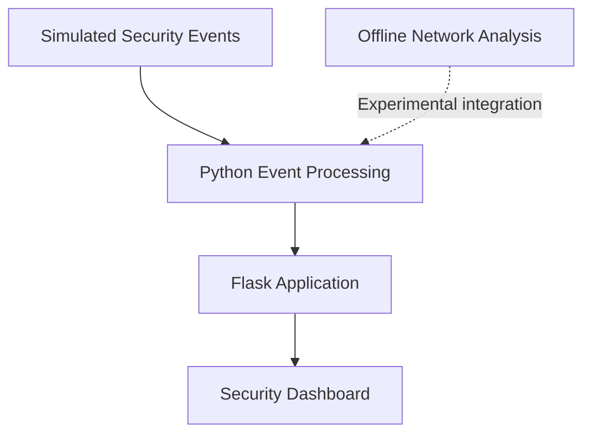

<!-- portfolio-overview:start -->

# 🛡️ Sentinel 2.0

### Python Cybersecurity Dashboard | Security Monitoring | Flask

Sentinel 2.0 is a Python-based cybersecurity
dashboard designed for exploring security-event
monitoring, threat visualization, and
intrusion-detection workflows.

The project provides a hands-on environment
for developing and testing defensive security
analytics.

## 🎯 Project Objectives

- Explore security operations center workflows
- Visualize security events in a web dashboard
- Experiment with intrusion detection
- Analyze suspicious network activity
- Develop Python security automation skills
- Connect security analysis tools together

## ⚡ Features

- Flask-based security dashboard
- Security-event visualization
- Simulated security activity for testing
- Security monitoring experiments
- Experimental integration with offline
  packet-capture and intrusion-detection tools

## 🏗️ Architecture



## 🛠️ Technology Stack

| Technology | Purpose |
|---|---|
| Python | Security analysis and backend logic |
| Flask | Web application framework |
| HTML / CSS | Dashboard interface |
| Git / GitHub | Version control |
| Network analysis | Security research and testing |

## 🔍 Security Research Focus

**Security Monitoring**

Experimenting with methods for organizing
and displaying security events.

**Intrusion Detection**

Exploring how suspicious network behavior
can be identified and reported.

**Security Automation**

Developing Python workflows that support
repeatable security analysis.

**System Integration**

Investigating connections between packet
analysis tools and centralized dashboards.

## 🚀 Getting Started

Clone the project:

```bash
git clone https://github.com/cabralisjota/sentinel-2.0.git
cd sentinel-2.0
```

Install Python dependencies:

```bash
pip install -r requirements.txt
```

Start the Flask application:

```bash
python app.py
```

Use the local address displayed by Flask to
access the dashboard.

## 🗺️ Development Roadmap

- [ ] Expand security-event analysis
- [ ] Improve dashboard filtering
- [ ] Add more detection experiments
- [ ] Improve network-forensics integration
- [ ] Add reproducible test datasets
- [ ] Document deployment and configuration
- [ ] Add screenshots and demonstrations

## 🔐 Responsible Use

This project is intended for cybersecurity
education, defensive research, and authorized
security testing.

It is an experimental learning project, not a
production-ready security monitoring system.

## 👨‍💻 Developer

**GitHub:** [@cabralisjota](https://github.com/cabralisjota)

**Focus:** Cybersecurity, Python, network
forensics, and security automation.

---

<!-- portfolio-overview:end -->

# Sentinel 2.0
### Cybersecurity Threat Intelligence Dashboard

https://sentinel-2-0.onrender.com/

Sentinel 2.0 is a Python Flask-based Security Operations
Center (SOC) dashboard designed for security monitoring
and threat visualization.

## Features
- Interactive geographic attack map
- Simulated cybersecurity event generation
- Animated attack routes and threat indicators
- Live security statistics
- Threat severity classification
- Security incident event stream
- Searchable security events
- Responsive dashboard interface

## Technologies
- Python 3
- Flask
- JavaScript
- HTML5 and CSS3
- Leaflet.js
- GeoJSON
- Canvas API
- Termux

## Installation

Install Flask:

    pip install flask

Run the application:

    python app.py

Open:

    https://sentinel-2-0.onrender.com/

## Project Status
Educational prototype under active development.

Current threat events are simulated. The application
does not currently inspect real network traffic or
provide production intrusion detection.

## Future Development
- SQLite event persistence
- Authentication log analysis
- Rule-based threat detection
- Incident investigation tools
- Defensive network monitoring

## Author
Independent cybersecurity development project.
